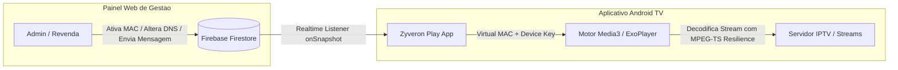

# 📺 Zyveron Play — Ecossistema Completo de Streaming para Smart TVs

> Plataforma profissional de alta performance e baixa latência para reprodução de listas autorizadas em Android TV, Fire TV Stick e TV Boxes, integrada a um Painel Web de Controle com ativação por MAC, troca em massa de DNS e gestão multi-nível de revendas.

---

## 🏛️ Arquitetura do Sistema

O **Zyveron Play** é dividido em duas frentes integradas em tempo real via **Google Firebase Firestore**:



---

## 🌟 Principais Diferenciais Técnicos

### 1. Painel Web de Controle (`panel/`)
* **Troca em Massa de DNS (Server Pointer):** Se uma operadora bloquear um DNS, o administrador altera o link no cadastro do servidor e **100% dos aparelhos vinculados atualizam instantaneamente**, sem necessidade de alterar o cadastro individual dos clientes.
* **Ativação por MAC + Device Key:** Cada ativação de 30 dias deduz automaticamente 1 crédito do revendedor e concede acesso imediato ao aparelho na TV.
* **Hierarquia Multi-nível de Revendas:** Super Admin > Revenda Master > Sub-revenda, com isolamento rigoroso de carteira de clientes.
* **Central de Notificações na TV:** Disparo de mensagens e comunicados de manutenção diretamente na tela do cliente (Global, por Revenda ou para um MAC individual).
* **Auditoria Contábil:** Histórico imutável de todas as recargas, transferências e ativações com créditos.
* **Visual *Cinematic Stealth Dark*:** Desenvolvido em Next.js 15, React 19 e Tailwind CSS v4, com paleta moderna e sem fadiga visual.

### 2. Aplicativo Android TV Nativo (`android-tv/`)
* **Virtual MAC Address:** Gera um identificador único de hardware (`MediaDrm` + `ANDROID_ID`) no formato `00:XX:XX:XX:XX:XX`, compatível com **100% dos Androids (TV Boxes, Fire Stick e Smart TVs)**, contornando o bloqueio de privacidade do Android 10+.
* **Motor Media3 / ExoPlayer Otimizado:**
  * **Tolerância a MPEG-TS:** Absorve saltos de pacotes e descontinuidades de PCR/PTS sem congelar a imagem.
  * **Zapping Ultra-Rápido:** Início de reprodução otimizado para ~1.5s com buffer adaptativo.
  * **Reconexão Silenciosa (Exponential Backoff):** Em micro-quedas de rede, tenta recuperar a transmissão em 1.5s, 3s e 6s mantendo o último quadro na tela, sem diálogos intrusivos.
* **Cache-First Local (Room Database):** Abre o catálogo em **menos de 1 segundo**, realizando a sincronização diferencial com o provedor em segundo plano.
* **Navegação D-Pad First a 60fps:** Controle remoto fluido com zapping pelas teclas ▲ / ▼ e grade lateral pelas teclas ◄ / OK.

---

## 🚀 Como Executar o Painel Web

### Pré-requisitos:
* Node.js 18+ instalado
* Gerenciador de pacotes `pnpm` (ou `npm`)

### Passo a passo:
```bash
# 1. Acesse o diretório do painel
cd panel

# 2. Instale as dependências (se necessário)
pnpm install

# 3. Configure as variáveis de ambiente (.env.local)
cp .env.example .env.local

# 4. Inicie o servidor em modo de desenvolvimento
pnpm run dev
```

Abra [http://localhost:3000](http://localhost:3000) no seu navegador.

Para compilar para produção:
```bash
pnpm run build
pnpm run start
```

---

## 📱 Como Compilar o Aplicativo Android TV (APK)

### Opção 1: Via Linha de Comando (Script Rápido no Windows)
Dentro da pasta `android-tv/`:
```bat
build-apk.bat
```
Escolha:
* `1` para gerar o **APK Debug** (ideal para testes locais via pendrive ou ADB).
* `2` para gerar o **APK Release** (com Proguard ativo e minificado).

### Opção 2: Via Android Studio
1. Abra o Android Studio e selecione **"Open"**.
2. Aponte para a pasta `c:\Users\carlo\OneDrive\Documentos\Projetos\Zyveron Play\android-tv`.
3. Aguarde o Gradle sincronizar as dependências (`androidx.media3`, `tv-compose`, `firebase`, `room`).
4. Clique em **Build > Build Bundle(s) / APK(s) > Build APK(s)**.

### Instalação no Fire TV Stick ou TV Box via ADB:
```bash
adb connect IP_DA_SUA_TV:5555
adb install app-debug.apk
```

---

## 🔒 Regras de Segurança do Firebase (`panel/firestore.rules`)

As regras garantem isolamento total:
1. **Servidores & DNS:** Apenas o `superadmin` pode alterar o DNS ativo.
2. **Aparelhos (MACs):** Cada revendedor só pode ler e gerenciar os aparelhos cadastrados em sua conta. O aplicativo de TV lê apenas os dados correspondentes ao seu próprio MAC.
3. **Créditos:** Deduções e transferências são registradas de forma atômica e auditada.

---

## 🧪 Validação e Testes Automatizados

O repositório inclui um teste de integração de ponta a ponta que valida:
* Formato do Virtual MAC e PIN.
* Ativação e débito atômico de créditos.
* Propagação instantânea da troca em massa de DNS.
* Recepção de mensagens na TV.
* Bloqueio imediato por inadimplência.

Para executar o validador:
```bash
node scripts/test-integration.mjs
```

---

## 📁 Estrutura de Diretórios

```
Zyveron Play/
├── panel/                  # Painel Web (Next.js 15, Tailwind v4, Firestore)
│   ├── src/app/            # Rotas (Dashboard, MACs, Servidores, Revendas, Mensagens, Logs)
│   ├── src/components/     # Sidebar, Navbar, Modais D-Pad
│   ├── src/context/        # AuthContext e RBAC
│   └── firestore.rules     # Regras de segurança em nuvem
│
├── android-tv/             # Aplicativo Nativo Android TV (Kotlin + Media3)
│   ├── app/src/main/java/  # Código Fonte Kotlin
│   │   ├── data/           # Room DB, Entidades e Firestore Manager
│   │   ├── player/         # Engine Media3 / ExoPlayer com tolerância a falhas
│   │   ├── ui/             # Telas Compose TV (Ativação, Player, Mensagens)
│   │   └── util/           # Virtual MAC e Device Key Helper
│   └── build-apk.bat       # Compilador de APK para Windows
│
└── scripts/                # Scripts de auditoria e testes de integração
```

